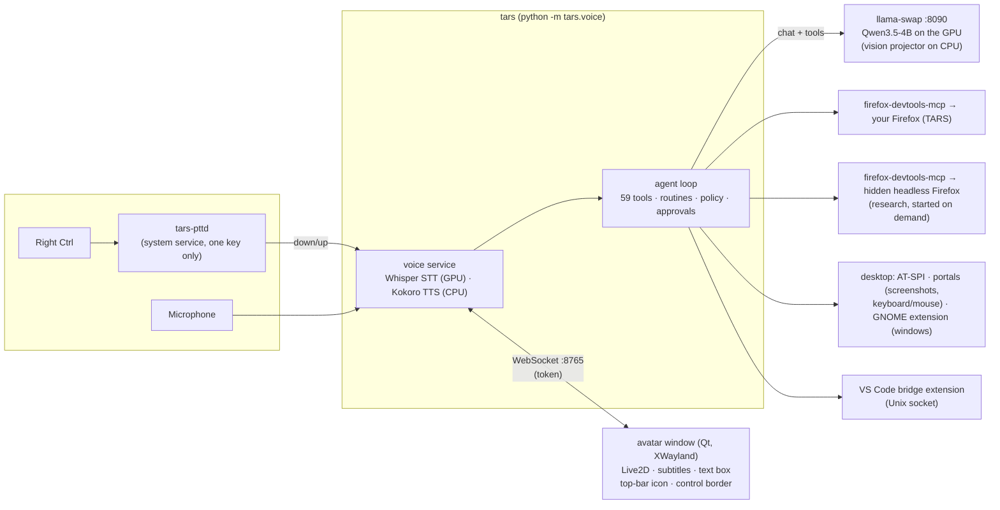

# How TARS works

The current system, as built. The full design and the plans for later phases
are in [PLAN.md](PLAN.md).

## Processes

| Piece | What it is |
|---|---|
| `tars/voice/` | Push-to-talk, recording, Whisper `small.en` on the GPU, Kokoro `af_heart` TTS streamed sentence by sentence, the turn loop, approvals, the kill switch |
| `tars/agent/` | The tool registry, permission tiers, the command policy, and the agent loop (native tool calling, up to 12 steps, loop detection, context budgeting) |
| `tars/tools/` | The tools themselves; [TOOLS.md](TOOLS.md) lists all 59 |
| `tars/perception/` | AT-SPI (accessibility trees over D-Bus), the Screenshot and RemoteDesktop portals, the window and VS Code clients |
| `tars/ui/` | The avatar window, its message bus, and the Live2D build |
| `tars/llm/` | Streaming chat client, llama-swap start-up, prompt-cache priming |
| `tars/mcp/` | A small MCP client and manager (used for the Firefox drivers) |
| `tars/memory/` | SQLite with full-text search: facts you told TARS and past turns |
| `tars/skills/` | Learned routines (finished tasks, with the request's words as slots) and routines you teach by name |
| `deploy/` | The GNOME Shell extension, the VS Code extension, the pttd systemd units, templates |

The second model in `config/tars.yaml` (`scout`, Qwen3.5-0.8B on the CPU) is set up
and benchmarked but not used yet; it's reserved for Phase 4's helper agents.

## One turn

1. Right Ctrl is released (or Enter in the text box). The recording goes to
   Whisper (~0.5 s).
2. A routine you taught ("study mode") runs its requests in order. Settings
   commands ("humor 40%") and unambiguous ones ("pause the music") are handled
   directly, without the model.
3. Otherwise the model gets the system prompt, the 59 tool descriptions, recent
   history and the new message, with the current time and any remembered facts.
4. If a learned routine fits the request, its steps run first, as if the model had
   proposed them; the model then only writes the answer, or carries on if a step
   failed. A successful multi-step turn is saved as a routine for next time.
5. It answers or calls tools. Each call passes the **policy** first (tier,
   site rules, sandbox) and may ask you. Results go back labelled as data.
6. Its words are spoken as they stream in, and shown as subtitles; each step shows
   in the window's task list.

**Speed comes from the prompt cache.** The system prompt and tool list (~4,200
tokens) take ~10 s to process cold, so they're kept byte-identical between turns
and primed at start-up; then a turn only processes the new words (first token
in ~0.35 s). Anything that varies (time, facts) goes in the user message, and
history keeps only short notes of what was done, not tool output.

## How TARS sees the screen

In order of preference:

1. **Structure, not pixels.** The accessibility tree for desktop apps (buttons and
   fields by name), the DOM of your Firefox, tmux for terminals, the VS Code
   extension for the editor and its terminal.
2. **Apps that expose nothing** (Spotube, games): a screenshot, with OCR for text
   labels and the model's vision for icons (`click_on_screen`).
3. **Looking:** the vision model reads a screenshot (`look_at_screen`).

After a click or typing, TARS re-reads the window and gets told what changed.

## How TARS acts

| Target | How |
|---|---|
| App buttons and fields | AT-SPI actions by element name |
| Typing and shortcuts | the RemoteDesktop portal (keyboard), into the focused window only |
| Clicking at a spot | the same portal (pointer), positioned from the window geometry the GNOME extension reports |
| Bringing a window forward | the GNOME extension (`org.tars.Windows`: list and focus only) |
| Firefox | Mozilla's firefox-devtools-mcp, wrapped by TARS's `web_*` tools with site rules and approvals |
| Commands | bash inside a bubblewrap sandbox |
| Your apps | `config/apps.yaml`: launch flags, file types, plus app-specific tools (Spotube, Super Productivity, Termius) |

## Where things live

| Path | Contents |
|---|---|
| `config/` | Defaults: `tars.yaml` (voice, models, personality), `sites.yaml` (per-site access), `apps.yaml` (your apps), `mcp.json` |
| `~/.config/tars/` | Your overrides (`tars.yaml` is merged over the default), `llama-swap.yaml` |
| `~/.local/share/tars/` | Models, binaries (`opt/`), the avatar build, `memory.db`, `skills.db` (routines), `logs/`, edit `backups/`, the keyboard approval token, `recordings/` (only with `--save-audio`) |
| `$XDG_RUNTIME_DIR/tars-vscode-*.sock` | The VS Code bridge, one per window |
